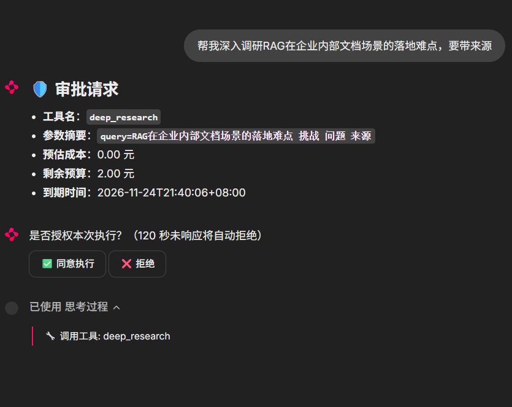

# AdaptiveSearchAgent

**会话式 Agent + 工具治理 + 外层审批**：模型自主选工具，工具调用受权限/预算/审批约束，
效果受评测门禁约束，行为有 trace/metrics 可查。**单人项目，单进程可跑。**

| 证据     | 数字                                                         |
| -------- | ------------------------------------------------------------ |
| 单测     | **230 passed / 234 收集**（238 总，4 skipped / 4 deselected） |
| 冻结契约 | **5 份** + **3 条架构契约**（import-linter，CI 强制）        |
| 用例台账 | **293 行**（15 个前缀，GB18030）                             |
| 评测     | 三组对照 A **9.70** / B **9.65** / C **9.65**（本地 §9）；云裁判历史 A 9.70 / B 9.75 / C 9.85（§8） |
| 可观测   | span 契约 v2 + 6 指标 + 3 条告警 + 跨层 E2E（SSE/DB/Redis/trace/metrics 五处一致） |



> 一次真实审批：危险工具执行前挂起 → 卡片给出工具、参数摘要、预估成本、剩余预算、到期时间 →
> 同意则继续、拒绝则**终止本轮**（零 token，不产生自造内容）。

## 30 秒跑起来

```bash
cd .. && docker compose up -d db_dev db_test redis && cd AdaptiveSearchAgent
poetry install
ENABLE_TOOL_POLICY=1 ENABLE_HITL=1 ENABLE_TRACE=1 ENABLE_SKILLS=1 \
  poetry run uvicorn api_main:app --port 8200
FASTAPI_BASE_URL=http://localhost:8200 poetry run chainlit run frontend/app.py --port 8202  # 另开终端
```

或 VSCode：`Ctrl+Shift+P` → `Start Demo Environment`（端口约定见 `.vscode/tasks.json`）。
健康检查 `curl localhost:8200/health`；指标 `curl localhost:8200/metrics`。

## 核心设计

1. **主循环只做路由，策略全部上移** — `agent ⇄ tools` 条件边，停在"模型不再返回 tool_calls"；
   压缩 / 校验 / 权限 / 审批都不在循环里，改策略不动循环。
2. **工具是登记出来的** — `ToolSpec` 九字段单一事实源 + schema 指纹冻结；执行器前置四道闸
   （权限 / 超时 / 次数 / 费用），记账到 Redis。
3. **审批在循环外层** — 八字段载荷经 SSE 下发，resume 时凭据原子消费（读到即删）+ 墓碑；
   重放 409 / 过期 410 / 不存在 404；按 `permission` 分档：`dangerous` 拒绝即终止本轮，其余回灌继续。
4. **上下文四层预算 + 落盘回读** — 压缩只改发给模型的视图，checkpoint 里永远是全量。
5. **可观测与评测** — trace 契约化（10 字段 / 6 kind / attrs 白名单）、6 指标、3 条告警；
   评测做成门禁：3 配置矩阵 + 三态判定 + 逐题符号检验，无效基线 / 非全量 / 跨版本一律拒绝或标注。

## 已知边界

| 边界                   | 说明                                                         |
| ---------------------- | ------------------------------------------------------------ |
| 无鉴权 / 无租户配额    | 单机内网 demo，单调用方                                      |
| 主循环未显式设步数上限 | 吃框架 `recursion_limit` 默认值                              |
| 容器镜像依赖陈旧       | 仅用于 PG/Redis；应用走本地进程（`app_dev` 镜像缺 `prometheus_client`，需 rebuild 才能容器化） |
| 评测单裁判、20 题      | 0.05 级差异不可分辨，靠重复跑与符号检验                      |
| prompt / 模型未版本化  | 不能灰度回滚                                                 |

## 文档

| 内容                                           | 位置                                                         |
| ---------------------------------------------- | ------------------------------------------------------------ |
| 架构与分层、依赖规则                           | [docs/architecture.md](docs/architecture.md)                 |
| 5 份冻结契约                                   | [docs/contracts/](docs/contracts/)                           |
| 评测门禁（判据 / 三态 / 守卫）                 | [docs/eval-gate.md](docs/eval-gate.md)                       |
| 可观测与告警                                   | [docs/observability.md](docs/observability.md)               |
| 安全（注入防护 / fail-closed）                 | [docs/security.md](docs/security.md)                         |
| 基线与评测数据（§7 raw / §8 云裁判 / §9 本地） | [docs/baseline.md](docs/baseline.md)                         |
| 用例台账（293 行）                             | [tests/test_agent_cases/台账用例.csv](tests/test_agent_cases/台账用例.csv) |

> 项目起步于固定 workflow（规划→并行搜索→评估→重试→写报告），后将其降级为 `deep_research` 工具、
> 外套 ReAct 主循环；重心理由与代价见 [docs/architecture.md](docs/architecture.md)。
