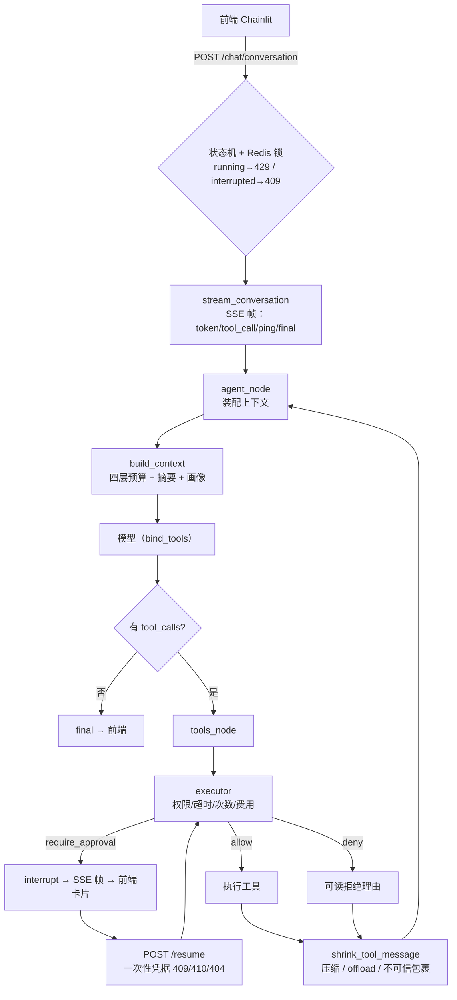
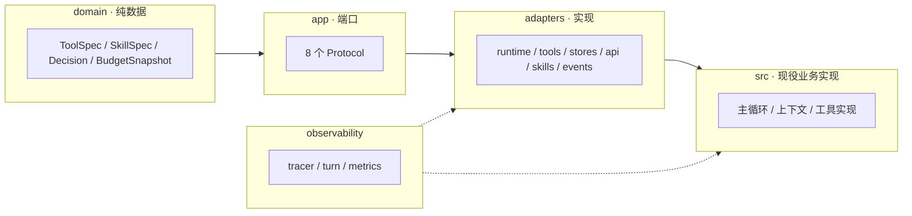
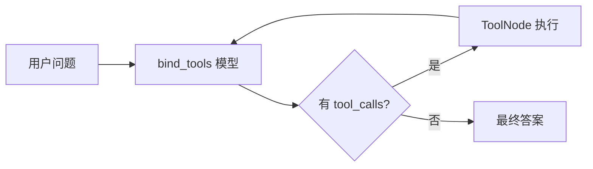

# AdaptiveSearchAgent

**一个会自己查资料、写调研报告的会话式 Agent。** 模型自己选工具，工具调用受治理（权限 / 预算 / 审批），
效果受评测门禁约束，行为有 trace + metrics 可查。单人项目，单进程可跑；225 条单测零外部依赖。


*一次真实会话：模型自主选工具 → 命中需审批的工具 → 弹出审批卡片 → 同意后继续流式输出（GIF 较大，原文件见 `docs/screenshots/adaptive.gif`）。*

## 这是什么

**会话式 Agent（LangGraph 主循环）+ 工具治理（注册表 / 权限 / 预算）+ 外层审批（HITL）。**

- **225** 条单测：`pytest -q` -> 225 passed / 4 skipped / 4 deselected
- **5** 份契约：`docs/contracts/`（approval / resume-http / runtime-event / tool-spec / trace-span）
- **220+** 条台账用例：`tests/test_agent_cases/台账用例.csv`（GB18030，15 列）
- **基线结论**：治理接入后未降质——A 9.70 / B 9.75 / C 9.85 vs raw 9.65（同裁判、同 20 题）

## 30 秒验证

不装数据库、不连模型也能验证核心结论：

| 想确认的事 | 一条命令 | 结果 / 代价 |
|---|---|---|
| 单测真的能跑 | `poetry run pytest -q` | 225 passed / 4 skipped / 4 deselected，41s，**零外部服务** |
| 分层真的没破 | `poetry run lint-imports` | 3 条契约 KEPT、0 broken（分析 74 文件 / 187 依赖） |
| 台账真的完整 | `poetry run python scripts/ci_check_ledger.py` | 293 行 / 15 列，0 problems |
| 指标真的在打 | `curl localhost:8200/metrics` | 6 Counter + 1 Histogram（需先起服务） |
| 评测门禁可判定 | `poetry run python -m evals.gate --baseline <run_id> --candidate <run_id>` | 三态判定（需先跑 `evals.run`） |

## 为什么难

三个问题决定了这个项目的形状，也对应下面的设计取舍：

1. **多轮 + 多工具容易跑飞**：模型会选错工具、重复调用、越滚越长。
   → 主循环只做路由（设计 1）；工具登记 + 四道闸（设计 2）；步数上限留在「演进方向」。
2. **成本和危险动作会失控**：搜索按次计费，危险工具可能造成事故。
   → 预算账本 + 权限判定（设计 2）；危险动作移到循环外审批、凭据一次性（设计 3）。
3. **改了不知道是变好还是噪声**：0.05 分的差异和抖动分不开，"我优化了"很容易是自嗨。
   → 评测门禁：判据取方差与单题当量的较大者、逐题符号检验、三态判定（设计 6）。

外加两条底线：行为要能查（设计 5），外部输入一律当不可信数据（设计 7）。

## 核心设计

### 1. 主循环只做路由，策略全部上移
`agent ⇄ tools` 条件边（`src/conversation_graph.py:290`），停在"模型不再返回 tool_calls"。
压缩、校验、权限、审批**一律不在循环里**——改策略不动循环。

### 2. 工具是登记出来的，不是写死的
`ToolSpec` 九字段单一事实源 + schema 指纹冻结（`c48c9d48…`）。
执行器前置四道闸：权限 / 超时 / 调用次数 / 费用，记账到 Redis（`tool_budget:<scope>`）。

### 3. 审批在循环外层，凭据一次性
危险工具 `interrupt` 挂起 → 八字段载荷经 SSE 下发 → resume 时 Lua 原子消费（读到即删）+ 墓碑。
重放 409、过期 410、不存在 404；状态落 `task_states`，**进程重启可恢复**。

### 4. 上下文四层预算 + 落盘回读
stable / history / 工具输出 / 输出预留四层预算 + 段落重要度压缩 + offload 落盘留指针。
**压缩只改发给模型的视图，checkpoint 里永远是全量消息。**

### 5. 可观测：契约化而非打日志
span 契约 v2（10 字段 / 6 kind / attrs 白名单）+ Langfuse/JSONL 双通道 +
6 个指标 + 3 条告警规则；一条跨层 E2E 同时断言 SSE / DB / Redis / trace / metrics 五处一致。

### 6. 评测门禁：拒绝无意义的比较
20 题黄金集 × 3 配置矩阵，结果落库 + 自动 diff + 三态判定（退化阻断 / 提升标记复核 / 持平通过）。
判据 `max(记录方差, 单题当量)` + 逐题符号检验；无效基线、题集不一致、非全量、
跨代码版本、数据集不一致**一律拒绝或显式标注**。

### 7. 工具生态与安全
MCP stdio 热插拔（停服降级不崩）、Skills 渐进披露（list→load，正文不进系统提示）、
子代理（独立上下文 + 递归守卫）；工具输出一律当不可信数据包裹并对边界做中和。

## 架构图

### 一次请求的流转



### 分层（六边形）



依赖方向由 3 条 import-linter 契约在 CI 强制（core-no-framework / app-independent / adapters-only-ports）。
deep_research 是 graph_factory.py 里保留的固定 workflow，已降级为工具，由主循环调用。

> search_worker 通过 HTTP 调用 RAG 子服务（rag-ingest-gateway）做本地知识库检索。

## 技术栈

- **核心**：Python 3.11 / LangGraph / FastAPI / PostgreSQL（pgvector + Checkpointer）/ Redis / Ollama
- **工程**：SSE 流式 / Docker Compose / pytest / Langfuse 追踪 / Chainlit 前端 / DeepSeek 备援 / Tavily 在线搜索

## 快速开始

**只想验证能跑（不需要模型 / 数据库 / Docker）**：

```bash
poetry install
poetry run pytest -q          # 225 passed / 4 skipped / 4 deselected，41s
```

**起完整服务**（前置：Docker、Ollama + `qwen35-9b-official`、父目录的 [rag-ingest-gateway](https://github.com/suimochuansheng/rag-ingest-gateway)）：

```bash
# 0. 依赖服务（PostgreSQL + Redis + RAG 入库；compose 在父目录）
cd .. && docker compose up -d db_dev db_test redis ingest_dev   # 起完回项目目录往下

# 1. 主服务后端（8200）
poetry run uvicorn api_main:app --reload --port 8200

# 2. 对话前端（8202）
FASTAPI_BASE_URL=http://localhost:8200 poetry run chainlit run frontend/app.py --port 8202
# 必须显式给 FASTAPI_BASE_URL，否则前端读到的还是 .env 里的 8000
```

> 健康检查 `curl localhost:8200/health` -> `{"status":"ok"}`；指标 `curl localhost:8200/metrics`。
> 端口约定来源：`.vscode/tasks.json`（Dev 8200/8201/8202，Test 8300/8301/8302）。

## 评测与门禁

改 prompt、改检索参数、换模型，都先过门禁再合入。

- **判据**：`max(记录方差 0.0408, 单题当量 0.05)`——差异小于这个数就当噪声，不宣称提升。
- **三态**：`PASS`（同口径无漂移）/ `WARN_IMPROVED`（超出噪声，需人工复核）/ `FAIL_DEGRADED`（退化，直接阻断）。
- **拒绝无意义比较**：无效基线、题集不一致、非全量、跨代码版本、数据集不一致，一律拒绝或显式标注。

```bash
poetry run python -m evals.run --configs A,B,C --set golden20
poetry run python -m evals.gate --baseline <run_id> --candidate <run_id>
```

## 量化结果

| 指标                | 值                                                           |
| ------------------- | ------------------------------------------------------------ |
| 单测                | **225 passed / 229 收集**（233 总，4 skipped、4 deselected） |
| 冻结契约            | **5 份**（approval / resume-http / runtime-event / tool-spec / trace-span） |
| 架构约束            | **3 条 import-linter**（core-no-framework / app-independent / adapters-only-ports），CI 强制 |
| 用例台账            | **293 行**（15 个前缀，GB18030）                             |
| 评测（本地复现 §9） | A 9.70 / B 9.65 / C 9.65，差异 1.0 题当量，符号检验 p=1.00   |
| 评测（历史基线 §8） | A 9.70 / B 9.75 / C 9.85 vs 改造前 raw 9.65                  |
| 观测                | 6 Counter + 1 Histogram + 3 条告警规则                       |
| 代码规模            | `agent/` ~4.9k 行 + `src/` ~4.8k 行（Python）                |

> §8 为云裁判历史基线，§9 为本地门禁复现，两套口径不可混用。

## 设计取舍

面试里常被追问"为什么这样做"，这里挑四个当时真有备选方案的：

| 决策 | 备选 | 为什么不选备选 | 付出的代价 |
|---|---|---|---|
| 主循环只路由，压缩 / 校验 / 权限 / 审批全部上移 | 在循环里直接做 | 改策略就得动循环，且无法单测 | 多一层 executor，链路更长 |
| 审批放循环外，凭据一次性（Lua 原子消费 + 墓碑） | 阻塞式等待 / 前端直连工具 | 无法跨进程恢复，重放不安全 | 多一套状态机与 409 / 410 / 404 |
| 评测用三态 + 逐题符号检验 | 只看平均分 | 0.05 级差异与抖动不可分辨 | 每轮跑三配置，要维护方差基线 |
| `deep_research` 保留为固定 workflow，但降级成工具 | 删掉 / 与主循环并列两个入口 | 删掉丢能力，双入口两套状态机 | 多一层工具封装 |

## demo（可复制）

### 1. 治理：四开关 + 审批卡片（主 demo）

```bash
ENABLE_TOOL_POLICY=1 ENABLE_TRACE=1 ENABLE_HITL=1 ENABLE_SKILLS=1 poetry run uvicorn api_main:app --port 8200
FASTAPI_BASE_URL=http://localhost:8200 poetry run chainlit run frontend/app.py --port 8202
# 打开 http://localhost:8202，设置面板切到"会话模式"
# 问「用深度调研对比三款 GPU 的功耗与性能」-> 弹审批卡片，点「同意」继续
# 点「拒绝」后立刻再发一句普通消息，应正常流式返回（卡住或 409 = 凭据未消费）
```

### 2. 冒烟：一条命令各验一件事（都不连模型）

| 一条命令 | 验的是什么 |
|---|---|
| `poetry run python scripts/smoke_injection.py` | 注入防护：输出被 `<untrusted source=...>` 包裹、边界中和，且不误伤正常内容 |
| `poetry run python scripts/smoke_tool_policy.py` | 权限 / 预算四道闸：allow / deny / require_approval / timeout 与账本口径 |
| `poetry run python scripts/smoke_mcp.py` | MCP 热插拔：注册前后工具数与 `bind_tools` 视图 |
| `poetry run python scripts/smoke_skills.py` | Skills 渐进披露：list -> load，路径穿越被拒 |

> 手动停 MCP server：`pkill -f scripts/mcp_server.py` 后再问一次，不崩（OI-UI-002：显式提示 P1 补）。

## 工程约束（CI 门禁）

`ci.yml` 六步，任一步失败即红：

| 步骤                 | 作用                                                |
| -------------------- | --------------------------------------------------- |
| `pytest --cov`       | 单测 + 覆盖率                                       |
| `lint-imports`       | 3 条架构契约（违规 import 直接拒）                  |
| `t11_checks.py`      | 三层骨架与依赖规则                                  |
| `t12_checks.py`      | 5 份契约快照未漂移                                  |
| `t63_checks.py`      | 权限与预算语用例                                    |
| `ci_check_ledger.py` | 用例台账完整性（15 列 / 唯一 ID / block 必须有 OI） |

另有 `eval-gate.yml`（手动 + 每周）跑评测门禁自测并上传报告 artifact。

## 已知边界

| 边界                   | 说明                            |
| ---------------------- | ------------------------------- |
| 无鉴权 / 无租户配额    | 单机内网 demo，单调用方         |
| 主循环未显式设步数上限 | 吃框架 `recursion_limit` 默认值 |
| 深调研单进程单飞       | 长任务并发会排队                |
| prompt / 模型未版本化  | 不能灰度回滚                    |
| 告警只交付规则文件     | 未接 Alertmanager               |
| 评测单裁判、20 题      | 0.05 级差异不可分辨，需重复跑   |
| CI 不跑真模型评测      | 无凭据，只验门禁逻辑            |

## 演进方向

以下六项均为**有意未做**——与「已知边界」一节逐条呼应：单人项目先把闭环跑通，不做扩张性投入。

| 方向 | 具体做法 | 预估 |
|---|---|---|
| prompt / 模型版本化 | 外置 `prompts/v1/*.md` + 版本号写入 span attrs，支持灰度回滚 | 半天 |
| 主循环步数上限 | 显式 `max_steps` + 重复动作检测（同工具同参数连续 N 次强制收尾） | 半天 |
| 检索参数实验 | vector / hybrid / +rerank 三组同题对照 | 半天 |
| 告警通道 | `alerts.yml` 接 Alertmanager 路由 + 值班通知 | 1 天 |
| 多 worker 指标 | prometheus multiprocess 模式 | 半天 |
| 故障演练 | 5 类注入（MCP 断 / RAG 断 / Redis 断 / 工具超时 / 注入攻击）+ 降级留证 | 半天 |

> 不做：K8s、多租户计费、自研向量库、评测 Web 界面（单人项目里是过度设计）。

## 项目结构

入口文件与目录一目了然；完整目录树折叠在下面。

<details>
<summary>目录树（点击展开）</summary>

```bash
AdaptiveSearchAgent/
├── api_main.py                 # FastAPI 入口：SSE 流式 / 会话 / 中断恢复 / metrics
├── config.py                   # Pydantic Settings 全局配置（含 ENABLE_* 开关）
├── agent/                      # 三层骨架
│   ├── domain/                 # 纯数据：ToolSpec / SkillSpec / Decision / BudgetSnapshot
│   ├── app/                    # 8 个端口（Protocol）：runtime/model/session/artifact/task/memory/event/budget
│   ├── adapters/               # 六类实现：runtime / tools / stores / api / skills / events
│   └── observability/          # tracer / turn / metrics：span 采集与指标口径
├── src/                        # 现役业务实现（后续迁往 agent/）
│   ├── conversation_graph.py   # 主循环：agent ⇄ tools 条件边
│   ├── conversation_stream.py  # 会话 SSE：token / tool_call / ping / final 帧
│   ├── context_manager.py      # 上下文四层预算 + 段落压缩 + offload 指针
│   ├── graph_factory.py        # 图工厂；deep_research 固定 workflow 已降级为工具
│   ├── agents/                 # 节点实现（含 HITL 确认、工具演示）
│   ├── tools/                  # 工具实现（RAG / Tavily / calculator / offload / stub）
│   ├── memory/                 # 画像抽取与上下文构建
│   └── utils/                  # LLM 备援、JSON 容错、指标、日志
├── docs/                       # contracts 5 份契约 / baseline §7§8§9 / architecture / observability / eval-gate / security / screenshots
├── evals/                      # run / store / gate / report / backfill；结果落 results/<run_id>/
├── skills/                     # 3 个 SKILL.md（citation-policy / cost-guard / rag-answer-format）
├── monitoring/                 # alerts.yml：3 条告警规则
├── scripts/                    # 8 个 smoke_*.py + e2e_flow + mcp_server + ci_check_ledger
├── tests/                      # 20 个卡级目录 + 293 行台账；contracts/ 契约测试；test_*.py 225 passed
└── frontend/                   # Chainlit 对话 UI（设置面板切会话模式）
```

</details>

## 附：工具路由最小演示（可选）

主流程之外保留一套独立的 ReAct 演示：默认关闭，`ENABLE_DYNAMIC_TOOLS=True` 开启后暴露 `POST /demo/tools`（`src/agents/tool_demo.py`）。



> 演示：`curl -X POST http://localhost:8200/demo/tools -H 'Content-Type: application/json' -d '{"query":"先搜索 OpenAI 2025 各季度营收，再用 calculator 求和"}'`；路由原则：内部文档 → `search_knowledge`，实时信息 → `search_tavily`，纯计算 → `calculator`，复杂问题多工具链式组合。
