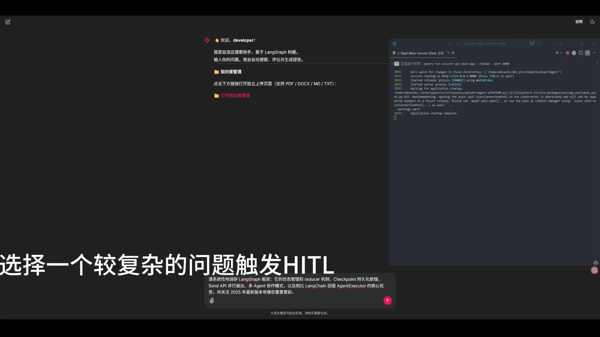
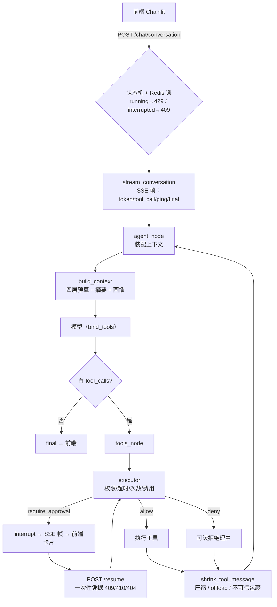
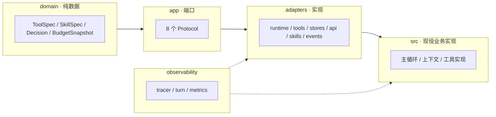
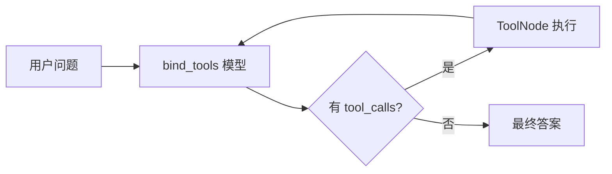

# AdaptiveSearchAgent

基于 LangGraph 的自适应搜索 Agent，实现「规划 → 并行搜索 → 评估 → 重试 → 生成报告」闭环，支持本地知识库（RAG）与在线搜索（Tavily）双路并行。

## 这是什么

**会话式 Agent（LangGraph 主循环）+ 工具治理（注册表 / 权限 / 预算）+ 外层审批（HITL）。**

- **225** 条单测：`pytest -q` -> 225 passed / 4 skipped / 4 deselected
- **5** 份契约：`docs/contracts/`（approval / resume-http / runtime-event / tool-spec / trace-span）
- **220+** 条台账用例：`tests/test_agent_cases/台账用例.csv`（GB18030，15 列）
- **基线结论**：治理接入后未降质——A 9.70 / B 9.75 / C 9.85 vs raw 9.65（同裁判、同 20 题）

---

AdaptiveSearchAgent搜索对话过程GIF（GIF加载慢，亦可进docs/screenshots/adaptive.gif 查看）


---

## 解决什么问题

当你提一个需要调研的问题（比如"对比几款 GPU 的功耗和性能"）时，系统自动拆解成多个搜索关键词，并行地从本地知识库和互联网同时搜索，然后评估找到的信息够不够——不够就自动补搜，够了就生成一份带来源和成本统计的 Markdown 调研报告。全程无需人工干预，只在可能产生高额搜索费用时主动向你确认。

---

## 核心设计

### 1. 主循环只做路由，策略全部上移
`agent ⇄ tools` 条件边（`src/conversation_graph.py:290`），停在"模型不再返回 tool_calls"。
压缩、校验、权限、审批**一律不在循环里**——改策略不动循环。

### 2. 工具是登记出来的，不是写死的
`ToolSpec` 九字段单一事实源 + schema 指纹冻结（`c48c9d48…`）。
执行器前置四道闸：权限 / 超时 / 调用次数 / 费用，记账到 Redis（`tool_budget:<scope>`）。

### 3. 审批在循环外层，凭据一次性
危险工具 `interrupt` 挂起 → 八字段载荷经 SSE 下发 → resume 时 Lua 原子消费（读到即删）+ 墓碑。
重放 409、过期 410、不存在 404；状态落 `task_states`，**进程重启可恢复**。

### 4. 上下文四层预算 + 落盘回读
stable / history / 工具输出 / 输出预留四层预算 + 段落重要度压缩 + offload 落盘留指针。
**压缩只改发给模型的视图，checkpoint 里永远是全量消息。**

### 5. 可观测：契约化而非打日志
span 契约 v2（10 字段 / 6 kind / attrs 白名单）+ Langfuse/JSONL 双通道 +
6 个指标 + 3 条告警规则；一条跨层 E2E 同时断言 SSE / DB / Redis / trace / metrics 五处一致。

### 6. 评测门禁：拒绝无意义的比较
20 题黄金集 × 3 配置矩阵，结果落库 + 自动 diff + 三态判定（退化阻断 / 提升标记复核 / 持平通过）。
判据 `max(记录方差, 单题当量)` + 逐题符号检验；无效基线、题集不一致、非全量、
跨代码版本、数据集不一致**一律拒绝或显式标注**。

### 7. 工具生态与安全
MCP stdio 热插拔（停服降级不崩）、Skills 渐进披露（list→load，正文不进系统提示）、
子代理（独立上下文 + 递归守卫）；工具输出一律当不可信数据包裹并对边界做中和。

---

## 量化结果

| 指标                | 值                                                           |
| ------------------- | ------------------------------------------------------------ |
| 单测                | **225 passed / 229 收集**（233 总，4 skipped、4 deselected） |
| 冻结契约            | **5 份**（approval / resume-http / runtime-event / tool-spec / trace-span） |
| 架构约束            | **3 条 import-linter**（core-no-framework / app-independent / adapters-only-ports），CI 强制 |
| 用例台账            | **293 行**（15 个前缀，GB18030）                             |
| 评测（本地复现 §9） | A 9.70 / B 9.65 / C 9.65，差异 1.0 题当量，符号检验 p=1.00   |
| 评测（历史基线 §8） | A 9.70 / B 9.75 / C 9.85 vs 改造前 raw 9.65                  |
| 观测                | 6 Counter + 1 Histogram + 3 条告警规则                       |
| 代码规模            | `agent/` ~4.9k 行 + `src/` ~4.8k 行（Python）                |

> §8 为云裁判历史基线，§9 为本地门禁复现，两套口径不可混用。

## 架构图

### 一次请求的流转



### 分层（六边形）



依赖方向由 3 条 import-linter 契约在 CI 强制（core-no-framework / app-independent / adapters-only-ports）。
deep_research 是 graph_factory.py 里保留的固定 workflow，已降级为工具，由主循环调用。

> search_worker 通过 HTTP 调用 RAG 子服务（rag-ingest-gateway）做本地知识库检索。

---

## 附：工具路由最小演示（可选）

主流程之外保留一套独立的 ReAct 演示：默认关闭，`ENABLE_DYNAMIC_TOOLS=True` 开启后暴露 `POST /demo/tools`（`src/agents/tool_demo.py`）。



> 演示：`curl -X POST http://localhost:8200/demo/tools -H 'Content-Type: application/json' -d '{"query":"先搜索 OpenAI 2025 各季度营收，再用 calculator 求和"}'`；路由原则：内部文档 → `search_knowledge`，实时信息 → `search_tavily`，纯计算 → `calculator`，复杂问题多工具链式组合。

---

## 技术栈

- **核心**：Python 3.11 / LangGraph / FastAPI / PostgreSQL（pgvector + Checkpointer）/ Redis / Ollama
- **工程**：SSE 流式 / Docker Compose / pytest / Langfuse 追踪 / Chainlit 前端 / DeepSeek 备援 / Tavily 在线搜索

---

## 快速开始

**前置依赖**：

- Docker（用于 PostgreSQL + Redis）
- Poetry（Python 依赖管理）
- Ollama + 已下载模型 `qwen35-9b-official`
- RAG 子服务已独立部署（见 [rag-ingest-gateway](https://github.com/suimochuansheng/rag-ingest-gateway)），与主服务放在同一父目录

```bash
# 0. 启动依赖服务（PostgreSQL + Redis + RAG 入库服务；compose 在父目录）
cd .. && docker compose up -d db_dev db_test redis ingest_dev   # 起完回项目目录再往下

# 1. 安装 Python 依赖
poetry install

# 2. 启动主服务后端（端口 8200）
poetry run uvicorn api_main:app --reload --port 8200

# 3. 启动对话前端（可选，端口 8202）
FASTAPI_BASE_URL=http://localhost:8200 poetry run chainlit run frontend/app.py --port 8202
# 必须显式给 FASTAPI_BASE_URL，否则前端读到的还是 .env 里的 8000
```

> 健康检查：`curl localhost:8200/health` 应返回 `{"status":"ok"}`；指标：`curl localhost:8200/metrics`
> 端口约定来源：`.vscode/tasks.json`（Dev 8200/8201/8202，Test 8300/8301/8302）。

---

## 四个 demo（可复制）

### 1. 治理：四开关 + 审批卡片

```bash
ENABLE_TOOL_POLICY=1 ENABLE_TRACE=1 ENABLE_HITL=1 ENABLE_SKILLS=1 poetry run uvicorn api_main:app --port 8200
FASTAPI_BASE_URL=http://localhost:8200 poetry run chainlit run frontend/app.py --port 8202
# 另开终端，打开 http://localhost:8202；先在设置面板切到"会话模式"（conversation）
# 问一句「用深度调研对比三款 GPU 的功耗与性能」-> 出现审批卡片，点「同意」继续
```

### 2. 审批：拒绝后继续（不卡 409）

```bash
# 同一会话：审批卡片点「拒绝」后，立刻再发一句普通消息
# 期望：正常流式返回 token（拒绝理由作为工具结果回灌主循环）
# 若卡住/报 409：凭据未消费（一次凭据由 Lua 原子消费 + 墓碑，读到即删）
```

### 3. 生态与质量：MCP 热插拔 + 评测门禁

```bash
ENABLE_MCP=1 poetry run uvicorn api_main:app --port 8200   # 启动时拉起 scripts/mcp_server.py
curl -s -X POST localhost:8200/chat/conversation -H 'Content-Type: application/json' \
  -d '{"thread_id":"mcp-demo","message":"数一下这句话有几个字：工具治理与审批"}'   # word_count 工具
pkill -f scripts/mcp_server.py   # 停 server；再问一次 -> 不崩（OI-UI-002：显式提示 P1 补）

# 评测门禁：三配置同题跑完，再与基线比对
poetry run python -m evals.run --configs A,B,C --set golden20
poetry run python -m evals.gate --baseline <run_id> --candidate <run_id>
```

> 判据 `max(记录方差 0.0408, 单题当量 0.05)`；三态 PASS / WARN_IMPROVED / FAIL_DEGRADED
> （退化阻断 / 提升标记复核 / 持平通过）。

### 4. 安全：注入防护

```bash
poetry run python scripts/smoke_injection.py   # 一条命令演示，不需要起服务
```

> 工具输出一律以 `<untrusted source=...>` 包裹，并对内部边界做中和（伪闭合标签、伪造分隔符）；
> 模型侧拿到的永远是数据，不是指令。

---

## 项目结构

```bash
AdaptiveSearchAgent/
├── api_main.py                 # FastAPI 入口：SSE 流式 / 会话 / 中断恢复 / metrics
├── config.py                   # Pydantic Settings 全局配置（含 ENABLE_* 开关）
├── agent/                      # 三层骨架
│   ├── domain/                 # 纯数据：ToolSpec / SkillSpec / Decision / BudgetSnapshot
│   ├── app/                    # 8 个端口（Protocol）：runtime/model/session/artifact/task/memory/event/budget
│   ├── adapters/               # 六类实现：runtime / tools / stores / api / skills / events
│   └── observability/          # tracer / turn / metrics：span 采集与指标口径
├── src/                        # 现役业务实现（后续迁往 agent/）
│   ├── conversation_graph.py   # 主循环：agent ⇄ tools 条件边
│   ├── conversation_stream.py  # 会话 SSE：token / tool_call / ping / final 帧
│   ├── context_manager.py      # 上下文四层预算 + 段落压缩 + offload 指针
│   ├── graph_factory.py        # 图工厂；deep_research 固定 workflow 已降级为工具
│   ├── agents/                 # 节点实现（含 HITL 确认、工具演示）
│   ├── tools/                  # 工具实现（RAG / Tavily / calculator / offload / stub）
│   ├── memory/                 # 画像抽取与上下文构建
│   └── utils/                  # LLM 备援、JSON 容错、指标、日志
├── docs/                       # contracts 5 份契约 / baseline §7§8§9 / architecture / observability / eval-gate / security / screenshots
├── evals/                      # run / store / gate / report / backfill；结果落 results/<run_id>/
├── skills/                     # 3 个 SKILL.md（citation-policy / cost-guard / rag-answer-format）
├── monitoring/                 # alerts.yml：3 条告警规则
├── scripts/                    # 8 个 smoke_*.py + e2e_flow + mcp_server + ci_check_ledger
├── tests/                      # 20 个卡级目录 + 293 行台账；contracts/ 契约测试；test_*.py 225 passed
└── frontend/                   # Chainlit 对话 UI（设置面板切会话模式）
```

---

## 工程约束（CI 门禁）

`ci.yml` 六步，任一步失败即红：

| 步骤                 | 作用                                                |
| -------------------- | --------------------------------------------------- |
| `pytest --cov`       | 单测 + 覆盖率                                       |
| `lint-imports`       | 3 条架构契约（违规 import 直接拒）                  |
| `t11_checks.py`      | 三层骨架与依赖规则                                  |
| `t12_checks.py`      | 5 份契约快照未漂移                                  |
| `t63_checks.py`      | 权限与预算语用例                                    |
| `ci_check_ledger.py` | 用例台账完整性（15 列 / 唯一 ID / block 必须有 OI） |

另有 `eval-gate.yml`（手动 + 每周）跑评测门禁自测并上传报告 artifact。

## 已知边界

| 边界                   | 说明                            |
| ---------------------- | ------------------------------- |
| 无鉴权 / 无租户配额    | 单机内网 demo，单调用方         |
| 主循环未显式设步数上限 | 吃框架 `recursion_limit` 默认值 |
| 深调研单进程单飞       | 长任务并发会排队                |
| prompt / 模型未版本化  | 不能灰度回滚                    |
| 告警只交付规则文件     | 未接 Alertmanager               |
| 评测单裁判、20 题      | 0.05 级差异不可分辨，需重复跑   |
| CI 不跑真模型评测      | 无凭据，只验门禁逻辑            |


## 演进方向

以下六项均为**有意未做**——与「已知边界」一节逐条呼应：单人项目先把闭环跑通，不做扩张性投入。

| 方向 | 具体做法 | 预估 |
|---|---|---|
| prompt / 模型版本化 | 外置 `prompts/v1/*.md` + 版本号写入 span attrs，支持灰度回滚 | 半天 |
| 主循环步数上限 | 显式 `max_steps` + 重复动作检测（同工具同参数连续 N 次强制收尾） | 半天 |
| 检索参数实验 | vector / hybrid / +rerank 三组同题对照 | 半天 |
| 告警通道 | `alerts.yml` 接 Alertmanager 路由 + 值班通知 | 1 天 |
| 多 worker 指标 | prometheus multiprocess 模式 | 半天 |
| 故障演练 | 5 类注入（MCP 断 / RAG 断 / Redis 断 / 工具超时 / 注入攻击）+ 降级留证 | 半天 |

> 不做：K8s、多租户计费、自研向量库、评测 Web 界面（单人项目里是过度设计）。
